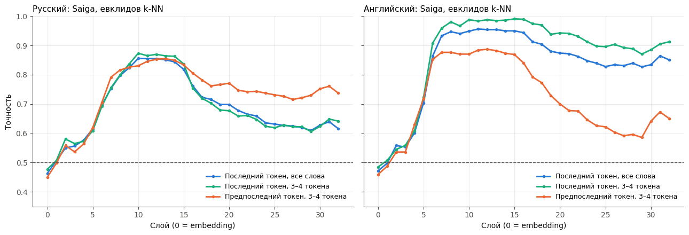
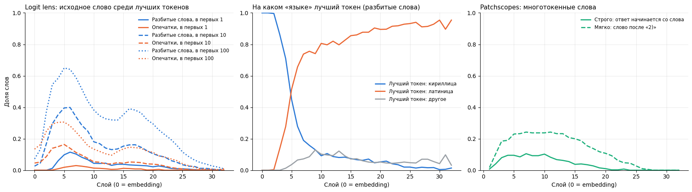
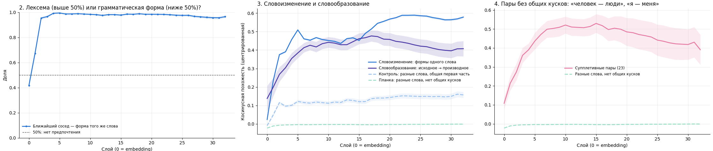
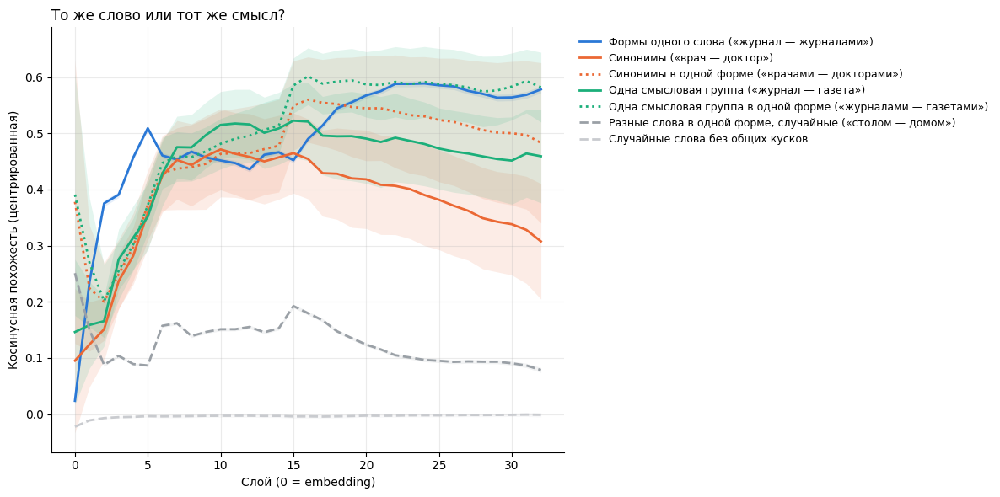

# Внутренний словарь русскоязычной языковой модели: детокенизация, словоизменение и словообразование

Исследовательский проект на основе статьи **[From Tokens to Words: On the Inner Lexicon of LLMs](https://arxiv.org/abs/2410.05864)** (Kaplan, Oren, Reif, Schwartz; ICLR 2025). Код авторов: **[schwartz-lab-NLP/Tokens2Words](https://github.com/schwartz-lab-NLP/Tokens2Words)**.

Мы переносим ключевые эксперименты статьи на **русский язык** и модель **Saiga (Llama 3 8B)** и добавляем собственный эксперимент о **морфологии**: что формирует модель — представление конкретной словоформы («журналами») или слова во всех его формах (лексемы «журнал»).


| Ноутбук | Эксперименты |
|---|---|
| [`01_word_vs_nonword.ipynb`](notebooks/01_word_vs_nonword.ipynb) | 1–2: слово или псевдослово; контроль на английском | 
| [`02_word_retrieval.ipynb`](notebooks/02_word_retrieval.ipynb) | 3: восстановление слова из скрытого состояния (logit lens, Patchscopes) | 
| [`03_morphology_lexeme_vs_form.ipynb`](notebooks/03_morphology_lexeme_vs_form.ipynb) | 4–5: словоизменение, словообразование, смысловой контроль | 


---

## Содержание

- [О статье](#о-статье)
- [Что сделано в проекте](#что-сделано-в-проекте)
- [Структура репозитория](#структура-репозитория)
- [Эксперименты](#эксперименты)
- [Результаты запусков](#результаты-запусков)
- [Основные результаты](#основные-результаты)
- [Установка и запуск](#установка-и-запуск)
- [Ограничения](#ограничения)
- [Декларация об использовании ИИ](#декларация-об-использовании-ии)
- [Цитирование](#цитирование)

---

## О статье

Языковая модель получает текст не по словам, а по **токенам** — фрагментам слов. Редкие и длинные слова разбиваются на несколько токенов, но модель обращается с ними как с целыми словами. Kaplan et al. исследуют, как это происходит внутри модели (Llama 2, английский язык):

- **Раздел 3.** По скрытому состоянию **последнего** токена многотокенного слова классификатор k-NN отличает настоящие слова от бессмысленных сочетаний токенов (89% на слое 13). По предпоследнему токену — только 61%. Значит, информация о слове формируется в последнем токене.
- **Раздел 4.** Слово можно восстановить из этого состояния: через *logit lens* для искусственно разрезанных однотокенных слов (более 80%) и через *Patchscopes* для настоящих многотокенных слов (64% на слоях 5–7).
- **Раздел 5.** Механизм: на первых слоях внимание последнего токена направлено на предыдущие куски слова, затем выходы FFN-блоков добавляют в его скрытое состояние представление целого слова. Если обнулить эти добавки, слово восстанавливается в 18% случаев вместо 85%.
- **Раздел 6.** Применение: словарь модели можно расширить без изменения её параметров, сократив число токенов в тексте на 10,5–14,5%.

Авторы называют это **внутренним словарём** (inner lexicon) модели: он шире списка её токенов.

Код авторов ([Tokens2Words](https://github.com/schwartz-lab-NLP/Tokens2Words)) содержит реализацию *logit lens*, *Patchscopes* и расширения словаря. Эксперимент 3 нашего проекта следует их коду (сравнение с входными эмбеддингами, функция внесения опечаток, промпт *Patchscopes*).

## Что сделано в проекте

| | Статья | Наш проект |
|---|---|---|
| Язык | английский | **русский** (+ английский как контроль) |
| Модель | Llama 2 7B | Saiga — Llama 3 8B, дообученная на русском; 4 бита |
| Слова | частотный список | `wordfreq` + словарная чистка `pymorphy3` |
| Псевдослова | позиционные пулы токенов | то же + **каноническая токенизация** и проверка по словарю |
| Статистика | один прогон | 5 случайных выборок, 95%-е интервалы, перестановочный тест |
| Классификаторы | k-NN | k-NN (евклидовое расстояние и косинус) + линейный классификатор |
| Восстановление слова | строгие метрики | строгие + **ранговые метрики** и мягкая проверка Patchscopes |
| Морфология | — | **новый эксперимент**: лексема или словоформа, словообразование, супплетивизм |
| Значение | — | **новый контроль**: формы одного слова против синонимов |

## Структура репозитория

```
interpretation_project_tokens2words/
├── notebooks/
│   ├── 01_word_vs_nonword.ipynb             эксперименты 1–2
│   ├── 02_word_retrieval.ipynb              эксперимент 3
│   └── 03_morphology_lexeme_vs_form.ipynb   эксперименты 4–5
├── results/                                       результаты наших запусков
│   ├── exp1_2_word_vs_nonword/
│   │   ├── res_01_word_vs_nonword.ipynb           выполненный ноутбук
│   │   ├── russian_words_and_pseudowords.csv      слова и псевдослова
│   │   ├── pseudoword_generation_stats.csv        статистика генерации псевдослов
│   │   ├── probe_accuracy_by_layer_all_runs.csv   точность по слоям, все зёрна
│   │   ├── probe_accuracy_by_layer_mean_ci.csv    точность по слоям, среднее и 95% ДИ
│   │   ├── permutation_null_by_layer.csv          шумовой уровень
│   │   ├── peak_summary.csv                       пиковые значения
│   │   ├── last_vs_penultimate.csv                последний против предпоследнего токена
│   │   ├── english_vs_russian.csv                 эксперимент 2: сравнение языков
│   │   ├── probe_accuracy_by_layer.png
│   │   ├── english_vs_russian.png
│   ├── exp3_word_retrieval/
│   │   ├── res_02_word_retrieval.ipynb            выполненный ноутбук
│   │   ├── split_words.csv                        разрезанные слова
│   │   ├── typo_words.csv                         слова с опечатками
│   │   ├── logit_lens_by_layer.csv                logit lens по слоям
│   │   ├── patchscopes_by_layer.csv               Patchscopes по слоям
│   │   ├── patchscopes_outputs.csv                ответы модели в Patchscopes
│   │   ├── summary.csv                            сводная таблица
│   │   ├── section4_retrieval_by_layer.png
│   │   ├── section4_rescored.png
│   ├── exp4_5_morphology/
│   │   ├── res_03_morphology_lexeme_vs_form.ipynb выполненный ноутбук
│   │   ├── noun_forms.csv                         формы существительных
│   │   ├── pair_similarity_by_layer.csv           похожесть пар А1–Г по слоям
│   │   ├── nearest_neighbor_lexeme_vs_form.csv    задача ближайшего соседа
│   │   ├── all_similarity_by_layer.csv            все типы пар
│   │   ├── criterion_by_layer.csv                 критерий лексемы по слоям
│   │   ├── semantic_control_by_layer.csv          эксперимент 5: смысловой контроль
│   │   ├── morphology_results.png
│   │   ├── semantic_control.png
│   └── figures/                                   графики для README и препринта
│       ├── exp1_word_nonword.png
│       ├── exp2_ru_vs_en.png
│       ├── exp3_rescored.png
│       ├── exp3_strict.png
│       ├── exp4_morphology.png
│       ├── exp4_panels.png
│       └── exp5_semantic.png
├── requirements.txt
└── README.md
```

Каждый ноутбук самостоятельный: устанавливает зависимости, загружает модель, собирает данные, сохраняет таблицы и графики и в конце скачивает их архивом. Готовые наборы данных не нужны: списки слов строятся из `wordfreq` и `pymorphy3`.

## Эксперименты

### Эксперименты 1–2. Слово или псевдослово — `01_word_vs_nonword.ipynb`

**Чему посвящены.** Отличает ли модель по скрытому состоянию последнего токена настоящее русское слово от бессмысленного сочетания токенов (раздел 3 статьи)? Отличается ли при этом русский от английского?

<details>
<summary>Подробнее о методе</summary>

- **Слова:** 100 000 частотных слов из `wordfreq`, только русские буквы. `pymorphy3` оставляет слова, известные словарю, без имён, фамилий, отчеств, топонимов, организаций и сокращений: 83 920 слов. Выбирается 1200 слов из 2–4 токенов (372/550/278).
- **Псевдослова** собираются из токенов, стоящих на тех же позициях в настоящих словах той же длины. Кандидат отбрасывается, если он есть в словаре, содержит не только русские буквы или имеет неканоническую токенизацию (`encode(decode(ids)) != ids`). 5 наборов (зёрна 42–46) и один набор без фильтров для сравнения.
- **Скрытые состояния** последнего и предпоследнего токенов со всех 33 уровней (эмбеддинги + 32 слоя).
- **Классификаторы:** k-NN (k = 4, евклид и косинус) и линейный (`StandardScaler → PCA(256) → LogisticRegression`); разбиение 80/20; 95%-е интервалы по 5 зёрнам; шум по 50 перестановкам меток.
- **Эксперимент 2:** тот же конвейер на английских словах в той же модели (2 зерна).
- **Результаты сохраняются** в `/content/saiga_russian_word_nonword_results_v2`.
</details>

### Эксперимент 3. Восстановление слова — `02_word_retrieval.ipynb`

**Чему посвящён.** Можно ли прочитать целое слово из скрытого состояния последнего токена (раздел 4 статьи), и почему для русского строгие метрики дают низкие числа?

<details>
<summary>Подробнее о методе</summary>

- **Разрезанные слова:** 1000 однотокенных слов режутся на 2–5 частей («директор» → `д|ир|ектор`). Скрытое состояние последнего куска сравнивается со всеми входными эмбеддингами (*logit lens*, как в коде авторов).
- **Опечатки:** 745 однотокенных слов с одной опечаткой (опечатки, дающие настоящее слово, исключены).
- **Patchscopes:** для 400 многотокенных слов состояние последнего токена с каждого слоя подставляется в промпт `Далее одно и то же слово дважды: 1) X 2)`; модель генерирует `L + 3` токена.
- **Пересчёт:** ранг исходного слова среди всех токенов (top-1/10/100), алфавит лучшего токена, мягкая проверка Patchscopes без нумерации `2)` в ответе.
- **Результаты сохраняются** в `/content/saiga_section4_results`.
</details>

### Эксперименты 4–5. Словоформа, лексема и значение — `03_morphology_lexeme_vs_form.ipynb`

**Чему посвящены.** Группирует ли модель формы одного слова вместе (лексема) или слова с одинаковым окончанием (грамматическая форма)? Чем словоизменение отличается от словообразования? Не объясняется ли сходство форм просто сходством значения?

<details>
<summary>Подробнее о методе</summary>

- **Словоизменение:** 250 существительных, формы в 6 падежах × 2 числах (`pymorphy3`), 1789 форм.
- **Словообразование:** 70 вручную отобранных пар пяти типов («стол → столик», «учить → учитель», «лес → лесной», «добрый → доброта», «писать → переписать»).
- **Супплетивизм:** 23 пары без общих токенов («человек — люди», «хороший — лучше»).
- **Смысловой контроль:** 15 пар синонимов и 20 пар слов одной темы, в начальной форме и в одной и той же форме.
- **Метод:** скрытое состояние последнего токена на каждом слое; из состояний вычитается среднее по набору, считается косинусное сходство. Пары сравниваются с контролями (общий первый токен без общего слова; нет общих токенов). Задача ближайшего соседа: что ближе к форме — другие формы того же слова или другие слова в той же форме (50% — нет предпочтения).
- **Результаты сохраняются** в `/content/saiga_morphology_results`.
</details>

## Результаты запусков

Папка [`results/`](results/) содержит результаты наших запусков в Google Colab (GPU T4): выполненные ноутбуки с сохранёнными выводами ячеек, таблицы CSV, которые сохраняют ноутбуки, графики и текстовые выводы. Чистые ноутбуки для повторного запуска лежат в [`notebooks/`](notebooks/); код в них тот же, из него только удалены комментарии.

В выполненных ноутбуках эксперимент 2, пересчёт метрик эксперимента 3 и эксперимент 5 идут отдельными ячейками в конце, так как они запускались после основной части. Из выводов удалены индикаторы загрузки и служебные виджеты Colab, остальное сохранено без изменений.

### Эксперименты 1–2: слово или псевдослово — [`results/exp1_2_word_vs_nonword/`](results/exp1_2_word_vs_nonword/)

| Файл | Содержание |
|---|---|
| `res_01_word_vs_nonword.ipynb` | выполненный ноутбук экспериментов 1–2 |
| `russian_words_and_pseudowords.csv` | отобранные слова и псевдослова: текст, токены, число токенов, набор (зерно) |
| `pseudoword_generation_stats.csv` | статистика генерации псевдослов: число попыток и отказов по каждой причине |
| `probe_accuracy_by_layer_all_runs.csv` | точность всех классификаторов по слоям для каждого зерна и условия |
| `probe_accuracy_by_layer_mean_ci.csv` | точность, усреднённая по 5 зёрнам, с 95%-ми доверительными интервалами |
| `permutation_null_by_layer.csv` | шумовой уровень по слоям (перемешанные метки) |
| `peak_summary.csv` | пиковая точность классификаторов: слой, интервал, значения на слое 0 и последнем слое |
| `last_vs_penultimate.csv` | последний против предпоследнего токена по слоям: разница и p-значения |
| `english_vs_russian.csv` | эксперимент 2: сводное сравнение русского и английского |
| `probe_accuracy_by_layer.png`, `english_vs_russian.png` | графики |

### Эксперимент 3: восстановление слова — [`results/exp3_word_retrieval/`](results/exp3_word_retrieval/)

| Файл | Содержание |
|---|---|
| `res_02_word_retrieval.ipynb` | выполненный ноутбук эксперимента 3 с пересчётом метрик |
| `split_words.csv` | искусственно разрезанные слова: слово, куски, токены |
| `typo_words.csv` | слова с опечатками: исходное слово, опечатка, токены |
| `logit_lens_by_layer.csv` | доля восстановленных слов по слоям (разрезанные слова и опечатки), по слою и накопленная |
| `patchscopes_by_layer.csv` | доля слов, восстановленных Patchscopes, по слоям |
| `patchscopes_outputs.csv` | все ответы модели в Patchscopes: слово, слой, текст ответа |
| `summary.csv` | сводная таблица трёх опытов вместе с числами статьи |
| `section4_retrieval_by_layer.png`, `section4_rescored.png` | графики: строгие метрики и после пересчёта |

Результаты пересчёта (top-10/100, алфавит лучшего токена, мягкая проверка Patchscopes) в CSV не сохранялись, они приведены в выполненном ноутбуке.

### Эксперименты 4–5: словоформа, лексема и значение — [`results/exp4_5_morphology/`](results/exp4_5_morphology/)

| Файл | Содержание |
|---|---|
| `res_03_morphology_lexeme_vs_form.ipynb` | выполненный ноутбук экспериментов 4–5 |
| `noun_forms.csv` | 1789 форм существительных: лемма, форма, падеж, число, токены |
| `pair_similarity_by_layer.csv` | средняя похожесть пар типов А1, А2, Б, В, Г по слоям |
| `nearest_neighbor_lexeme_vs_form.csv` | задача ближайшего соседа: доля «то же слово» по слоям с интервалами |
| `all_similarity_by_layer.csv` | похожесть всех типов пар, включая словообразовательные и супплетивные |
| `criterion_by_layer.csv` | критерий лексемы по слоям: какие условия выполнены |
| `semantic_control_by_layer.csv` | эксперимент 5: похожесть синонимов и слов одной смысловой группы по слоям |
| `morphology_results.png`, `semantic_control.png` | графики |


## Основные результаты

Графики ниже — из наших запусков на Colab T4.

**1. Внутренний словарь есть и у русской модели.** k-NN отличает слова от псевдослов с точностью до **85,6%** (слои 10–15), линейный классификатор — до **93,1%**; в статье 89%.

**2. Русский отличается от английского.** Последний токен русского слова лишь на **1,8 п. п.** информативнее предпоследнего, а на поздних слоях предпоследний даже лучше. В той же модели на английских словах разница **+10,4 п. п.**, как в статье. Значит, это свойство языка.



**3. Строгие метрики занижают результат для русского.** Начиная со средних слоёв лучший токен — английский (у состояния для «д|ир|ектор» это `Director`). Исходное русское слово при этом входит в первые 100 токенов для **65%** слов (слой 5). Patchscopes без учёта нумерации восстанавливает **24,2%** слов против 10,5% по строгой проверке.



**4. Модель группирует формы в лексему со второго слоя.** На слое 5 ближайший сосед формы — форма того же слова в **99,4%** случаев. Это верно и для пар без общих токенов: «человек — люди» имеют сходство **0,44** против 0 у случайных пар. Словообразовательные пары сходны слабее форм одного слова, а после 16-го слоя различие усиливается.



**5. Сначала слово, потом значение.** Формы одного слова ближе синонимов на слоях **2–5**; на слоях примерно 6–16 синонимы и слова одной темы их догоняют; на поздних слоях снова важна конкретная форма.



Подробные таблицы и обсуждение — в препринте.


## Установка и запуск

### Локально

Нужен GPU NVIDIA с CUDA (мы запускали на T4 с 16 ГБ видеопамяти).

```bash
git clone https://github.com/AngelinaLip/interpretation_project_tokens2words.git
cd interpretation_project_tokens2words
pip install -r requirements.txt
jupyter notebook notebooks/
```

Пути вида `/content/...` рассчитаны на Colab; при локальном запуске поменяйте `RESULT_DIR` в ячейке настроек.

## Ограничения

- Использована одна модель (Saiga, 4 бита); Llama 2 из статьи мы не запускали, поэтому сравнение с её числами качественное.
- Saiga — чат-модель; вместе с русским промптом и коротким ответом это может занижать результаты Patchscopes.
- Списки синонимов, словообразовательных и супплетивных пар невелики, границы слоёв в экспериментах 4–5 приблизительны.
- Значимость по слоям приводится без поправки на множественные сравнения.
- Эксперименты статьи с FFN, вниманием и расширением словаря не повторялись.

## Декларация об использовании ИИ

При подготовке проекта использовался ассистент **Claude (Anthropic)** в приложении Claude. С его помощью:

- обсуждались план экспериментов и модификации методики: каноническая токенизация псевдослов, словарная фильтрация, несколько случайных выборок и перестановочный тест, контроль на английском, ранговые метрики и мягкая проверка Patchscopes, смысловой контроль. Идея эксперимента о словоизменении и словообразовании была предложена преподавателем курса и развернута авторами проекта (Липина, Мальцева, Чугаева);
- написан и отлажен код ноутбуков Google Colab на основе кода [репозитория авторов статьи](https://github.com/schwartz-lab-NLP/Tokens2Words);
- интерпретировались результаты и выполнялся поиск литературы;
- подготовлены черновики текста препринта, этого README, презентации и схематических иллюстраций.

Все эксперименты запускались авторами проекта; все числа и графики получены из вывода этих запусков. Текст и интерпретации проверены авторами. 

## Цитирование

Оригинальная статья:

```bibtex
@inproceedings{kaplan2025tokens,
  title     = {From Tokens to Words: On the Inner Lexicon of LLMs},
  author    = {Kaplan, Guy and Oren, Matanel and Reif, Yuval and Schwartz, Roy},
  booktitle = {International Conference on Learning Representations (ICLR)},
  year      = {2025},
  url       = {https://arxiv.org/abs/2410.05864}
}
```

Этот проект:

```bibtex
@misc{saiga_tokens_to_words_ru,
  title  = {Внутренний словарь русскоязычной языковой модели: детокенизация, словоизменение и словообразование},
  author = {Мальцева Анастасия, Чугаева Кира, Липина Ангелина},
  year   = {2026},
  url    = {https://github.com/AngelinaLip/interpretation_project_tokens2words}
}
```

Использованные ресурсы: модель [IlyaGusev/saiga_llama3_8b](https://huggingface.co/IlyaGusev/saiga_llama3_8b), [wordfreq](https://github.com/rspeer/wordfreq), [pymorphy3](https://github.com/no-plagiarism/pymorphy3), методы [logit lens](https://www.lesswrong.com/posts/AcKRB8wDpdaN6v6ru/interpreting-gpt-the-logit-lens) и [Patchscopes](https://arxiv.org/abs/2401.06102).
